<!-- ============================== Header ============================== -->

  

  Web・モバイルを中心に、幅広いアプリケーション開発に取り組んでいます。
   
  <em>Crafting innovative applications across web and mobile.</em>

 

<!-- ============================ Tech Stack ============================ -->
<h3 align="center">Tech Stack</h3>

<!--
  ✏️ TECH_NAME を実際に使っている技術に差し替えてください（不要なカテゴリは行ごと削除）。
  書式:
    
  - 表示名のスペースは「_」、ハイフンは 2 つ重ねて書きます（shields.io の仕様）
  - アイコン名は https://simpleicons.org で検索した slug を小文字で指定します
  例（書式見本です）:
    
-->

  <code>LANGUAGES</code>
   
  

  <code>FRONTEND</code>
   
  

  <code>MOBILE</code>
   
  

  <code>BACKEND</code>
   
  

  <code>TOOLS</code>
   
  

 

<!-- ========================= GitHub Statistics ========================= -->
<!-- 下の 4 枚は .github/workflows/profile-cards.yml が毎日自動生成します -->
<h3 align="center">GitHub Statistics</h3>

  
  

  

  

<!-- ============================== Connect ==============================
  SNS・連絡先を載せる場合はコメントを外し、YOUR_... を差し替えてください。

<h3 align="center">Connect</h3>

  
  
  
  

===================================================================== -->

  

