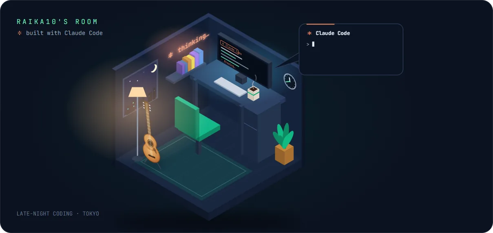

<!-- ============================== Header ==============================
  画面幅 768px 以上（PC）：カットインなどの演出つきの SVG
  それ以外（スマホ・GitHub アプリ）：軽く再生できるアニメーション WebP
  どちらも tools/banner で作り直せます
-->

  <picture>
    <source media="(min-width: 768px)" srcset="https://github.com/raika10/raika10/raw/main/assets/banner-v8.svg" />
    
  </picture>

  Web・モバイルを中心に、幅広いアプリケーション開発に取り組んでいます。
   
  <em>Crafting innovative applications across web and mobile.</em>

 

<!-- ========================= GitHub Statistics ========================= -->
<!-- 下の 3 枚は .github/workflows/profile-cards.yml が毎日自動生成します -->

  
  

  

<!-- ============================== Room ==============================
  作業部屋のミニチュア（Claude Code と一緒に作業中）。tools/banner で npm run build:room を実行すると作り直せます
-->

  

<!-- ============================== Connect ==============================
  SNS・連絡先を載せる場合はコメントを外し、YOUR_... を差し替えてください。

<h3 align="center">Connect</h3>

  
  
  
  

===================================================================== -->
