<!-- ============================== Header ============================== -->

  

  Web・モバイルを中心に、幅広いアプリケーション開発に取り組んでいます。
   
  <em>Crafting innovative applications across web and mobile.</em>

 

<!-- ========================= GitHub Statistics ========================= -->
<!-- 下の 3 枚は .github/workflows/profile-cards.yml が毎日自動生成します -->
<h3 align="center">GitHub Statistics</h3>

  
  

  

<!-- ============================== Connect ==============================
  SNS・連絡先を載せる場合はコメントを外し、YOUR_... を差し替えてください。

<h3 align="center">Connect</h3>

  
  
  
  

===================================================================== -->
